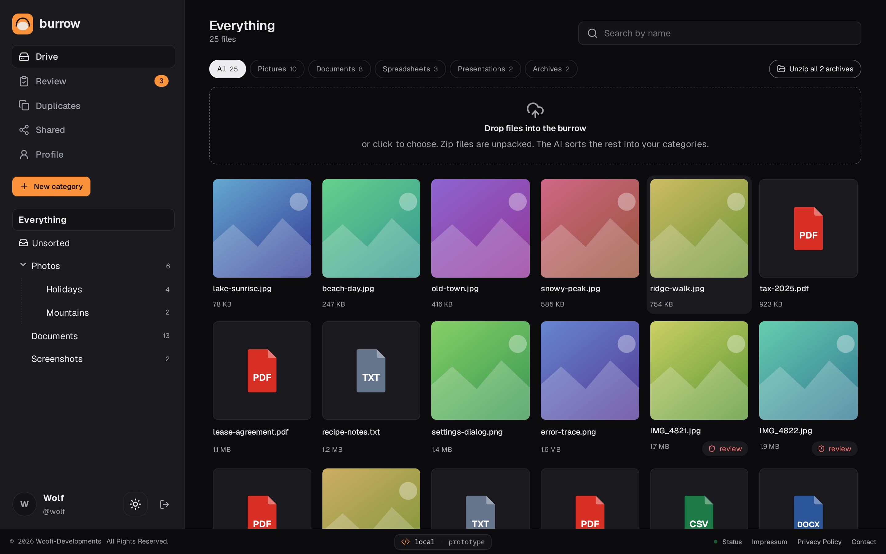
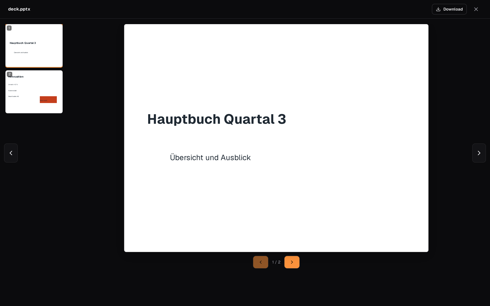
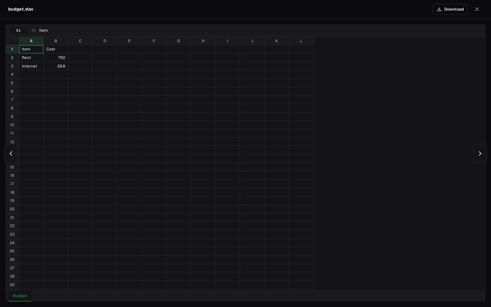
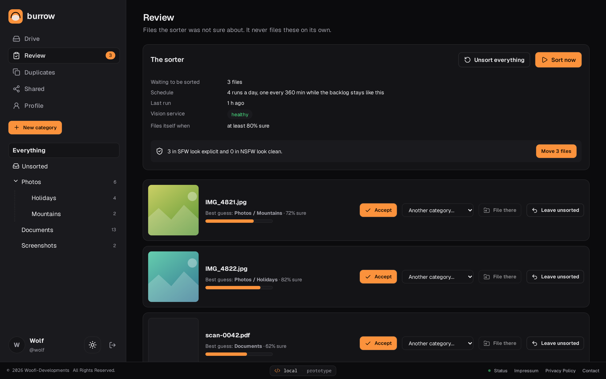
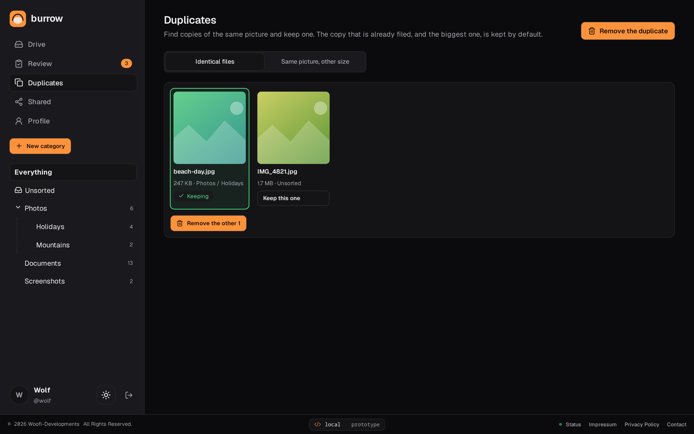
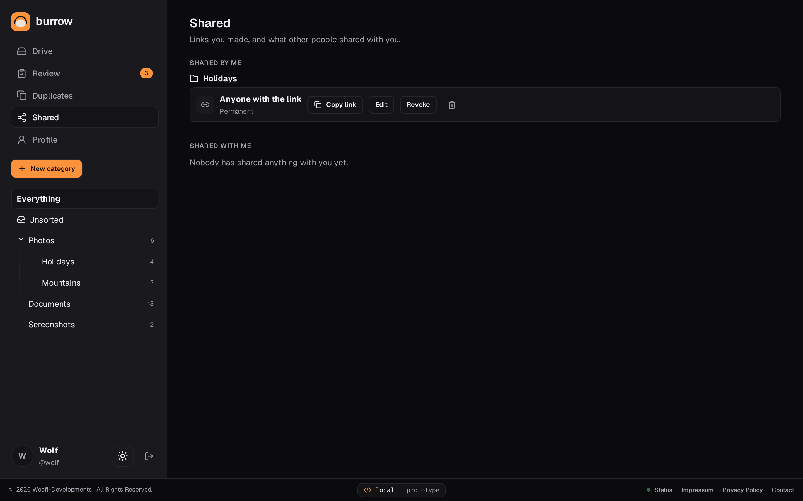
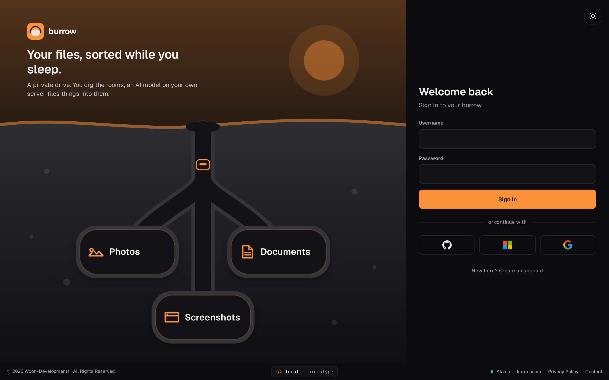

<div align="center">

# burrow — Private File Drive with Automatic Sorting

**Store any file, find it again, and let a self-hosted AI file it for you.**
Upload pictures, documents, spreadsheets, archives or whole folders; burrow sorts them into a category tree you define, previews almost everything in the browser, and shares what you choose by link.

**[burrow.woofi-developments.at](https://burrow.woofi-developments.at)** — a private instance, sign-in required

[](https://github.com/Wolfi-OwO/burrow/actions/workflows/ci.yml)
[](https://github.com/Wolfi-OwO/burrow/actions/workflows/security.yml)
[](https://github.com/Wolfi-OwO/burrow/releases/latest)
[](./LICENSE)
[](https://codecov.io/gh/Wolfi-OwO/burrow)

[](https://github.com/Wolfi-OwO/burrow/issues)
[](https://github.com/Wolfi-OwO/burrow/graphs/contributors)
[](CONTRIBUTING.md)


</div>


<div align="center"><sub>A 20-second tour of the drive, the in-browser viewer, review, duplicates and shared links, recorded from the prototype with sample data.<br/>Also available as <a href="docs/demo/burrow-demo.mp4">full-resolution video</a> (60 fps).</sub></div>

## Features

### Drive



- **Upload anything**: drop files or a whole `.zip`; zips (even nested ones) are unpacked on the server into the folder you are in. Files from 48 MB up are sent in 16 MB pieces, eight at a time, each retried on its own, so a multi-gigabyte upload survives a flaky line. Uploads keep running in a panel in the corner while you browse other pages.
- **A tree you define**: categories of any depth, drag and drop, atomic subtree moves (Postgres `ltree`).
- **Filters and search**: one chip per kind of file (pictures, documents, spreadsheets, presentations, code, routes, archives), ranked name search that also matches the recognised place of a photo.
- **Content-addressed storage**: identical bytes are stored once, however often they are uploaded.
- File names are tidied on the way in (`Report%20(1).pptx` becomes `Report (1).pptx`).

### Viewer



- Pictures, PDF, Word (`.docx`, legacy `.doc`), Excel (`.xlsx`, `.xls`, CSV), PowerPoint (`.pptx`, `.ppt`), OpenDocument, text, source code with syntax highlighting, Markdown, JSON, audio, video and zip listings, all rendered **in the browser**; nothing is uploaded to a third party.
- Routes (`GPX`, `TCX`, `KML`, `GeoJSON`) are drawn as a map with distance, climb, time and an elevation profile, without map tiles.



- Presentations open as slides, spreadsheets as a spreadsheet; arrow keys move through slides and then on to the next file.

### Automatic sorting and review



- A scheduled job files **pictures by what is in them** (zero-shot OpenCLIP against your own folder names, a dedicated NSFW model for SFW/NSFW branches) and **other files by type** (a folder named `DOCX`, `GPX` or `Documents` takes matching files).
- Anything it is unsure about goes to a **review queue**; it never guesses silently, and a file nothing fits stays in Unsorted.
- "Sort all now" runs in the background with a progress bar and no time limit.
- Photos get a **place guess** (GPS tag plus a landmark and scene guess), searchable.

### Duplicates



- Finds identical files and the same picture in other sizes; the copy that is already filed, and the biggest one, is kept by default.

### Sharing



- A link to a file or a whole category: open to anyone with it, or only to the accounts you pick; permanent or expiring, revocable at any time. A revoked, expired or unknown link answers the same 404.

### Accounts and security



- Password (Argon2id) or GitHub, Microsoft and Google sign-in, with revocable sessions; the first account becomes the admin and registration stays closed afterwards.
- A profile with an avatar (taken from your own files if you like), a light and a dark look, thumbnails, live notifications over server-sent events.

<div align="center"><sub>Screenshots are captured from the prototype (<code>prototypes/</code>) at 1440×900 with sample data, so no personal files appear here.</sub></div>

## Why it is built this way

- **Two services, one database.** `apps/api` (Node.js, Express, PostgreSQL) owns users, files and the tree. `apps/vision` (Python, FastAPI, ONNX Runtime) owns inference only: it receives a picture, returns scores and keeps nothing, with no database and no internet route. A bug or a bad dependency in the inference stack has no path to user data. See [ADR-0001](organizational/adr/0001-api-vision-split.md).
- **The model has to be self-hosted.** Sorting private pictures, including adult content, into their own branch is a stated goal, and every mainstream cloud vision API forbids classifying that. So there is no cloud option, only a model on my own server.
- **Zero-shot, against your own words.** Categories are whatever you name them, so the sorter scores each picture against your folder names under several phrasings (the name, "&lt;name&gt; artwork", "an illustration of &lt;name&gt;", plus aliases) and sums them. Scoring the bare name alone lost drawn artwork to a competing "a screenshot" label before this.
- **Ratings come from a dedicated model, not from labels.** A level whose folders are SFW and NSFW is decided by the NSFW classifier's score, because zero-shot labels are unreliable for it.
- **A file is stored once.** Storage is content-addressed on the VPS disk, with a nightly encrypted offsite backup ([ADR-0002](organizational/adr/0002-storage-layout.md), [ADR-0006](organizational/adr/0006-local-store-encrypted-offsite-backup.md)).
- **Big uploads are pieces.** A single 7 GB request cannot be retried; 16 MB pieces can, and the server writes them straight into place, so finishing takes seconds.
- Every decision has an ADR in [`organizational/adr/`](organizational/adr/).

## Tech stack

| Component     | Stack                                                                      |
| ------------- | -------------------------------------------------------------------------- |
| Frontend      | React 19, Vite, TypeScript, TanStack Query                                 |
| API server    | Node.js, TypeScript, Express 4, PostgreSQL 16, zod                         |
| Vision server | Python, FastAPI, ONNX Runtime (self-hosted OpenCLIP and an NSFW model)     |
| Database      | PostgreSQL 16 — `ltree` for the category tree, `pgvector` for embeddings   |
| Previews      | mammoth, SheetJS, read-excel-file, fflate, highlight.js, marked, DOMPurify |
| Infra         | Docker per service, Caddy in front, GitHub Actions for CI and release      |

## Getting started

### Prerequisites

- **Docker** with Compose, about 2 GB of downloads and a few minutes for the first build (it exports the ONNX models once)
- For development without Docker: **Node.js ≥ 22**, **Python 3.11**, and PostgreSQL 16 with the `pgvector` extension

### Run it with Docker

```bash
cp .env.example .env      # set JWT_SECRET (openssl rand -base64 48)
docker compose up --build
```

Then open <http://localhost:8080> and create the owner account. The first account becomes the admin; registration stays closed afterwards.

### Run it for development

```bash
npm ci
npm run database:migrate -w apps/api     # needs DATABASE_URL, see .env.example
npm run dev -w apps/api                  # :8080
npm run dev -w apps/frontend             # :5173, proxies /api to :8080
cd apps/vision && pip install -r requirements-export.txt && python scripts/export_models.py
```

## Project structure

```text
apps/api/                     Application server: Express, Postgres, scheduler, SSE
apps/vision/                  AI service: FastAPI, ONNX Runtime, no database
apps/frontend/                Web client: React, Vite
prototypes/                   Clickable prototype with a mocked API (source of the screenshots)
mockups/, wireframes/         Static design stages
e2e/                          End-to-end smoke test against a running stack
organizational/adr/           Architecture decision records
organizational/requirements/  Functional requirements
organizational/deploy/        VPS runbook, deploy and backup scripts
docs/                         Screenshots and the demo clip
```

## Testing & quality

| Check            | What it covers                                                         | Where it runs |
| ---------------- | ---------------------------------------------------------------------- | ------------- |
| API tests        | 100 tests against a real PostgreSQL with pgvector; about 91 % of lines | CI, locally   |
| Vision tests     | 17 tests with real model inference; about 98 % of lines                | CI, locally   |
| End-to-end smoke | the built images started with Compose, then a user flow                | CI            |
| Lint and types   | ESLint, Prettier, `tsc -b`, markdownlint                               | CI, locally   |
| Security scans   | gitleaks, Trivy, CodeQL                                                | CI            |

```bash
npm test -w apps/api               # needs DATABASE_URL, a Postgres with pgvector
npm run test:coverage -w apps/api  # same, with a coverage report in apps/api/coverage
cd apps/vision && python -m pytest --cov=app
node --test e2e/smoke.test.mjs     # against a running stack, BASE_URL=http://localhost:8080
```

Coverage is uploaded to [Codecov](https://codecov.io/gh/Wolfi-OwO/burrow) from CI.

## CI/CD — GitHub Actions

| Workflow                                         | Trigger                    | What it does                                                                                                                  |
| ------------------------------------------------ | -------------------------- | ----------------------------------------------------------------------------------------------------------------------------- |
| [`ci.yml`](.github/workflows/ci.yml)             | push, pull request         | repository hygiene, lint, format, types, tests with coverage, vision tests, end-to-end smoke, only for the parts that changed |
| [`security.yml`](.github/workflows/security.yml) | push, pull request, weekly | gitleaks, Trivy, CodeQL                                                                                                       |
| [`release.yml`](.github/workflows/release.yml)   | GitHub release             | plan, build the web image (and the vision image on request), deploy behind an approval, tidy the registry                     |

A release builds an image named after a hash of the code it contains, so an unchanged service is not rebuilt, and the deploy waits for one approval in the `production` environment. Details: [`organizational/deploy/README.md`](organizational/deploy/README.md).

## Documentation

| Document                                                                     | What it covers                                 |
| ---------------------------------------------------------------------------- | ---------------------------------------------- |
| [`organizational/adr/`](organizational/adr/)                                 | architecture decisions, ADR-0001 to 0006       |
| [`organizational/requirements/`](organizational/requirements/)               | functional requirements, FR-001 onwards        |
| [`organizational/deploy/README.md`](organizational/deploy/README.md)         | VPS runbook, deploy, backups                   |
| [`organizational/release-checklist.md`](organizational/release-checklist.md) | what to check before a release                 |
| [`CHANGELOG.md`](CHANGELOG.md)                                               | what changed in each version                   |
| [`CONTRIBUTING.md`](CONTRIBUTING.md) · [`SECURITY.md`](SECURITY.md)          | ground rules and how to report a vulnerability |
| [Impressum](IMPRESSUM.md) · [Privacy](PRIVACY.md) · [Terms](TERMS_OF_USE.md) | legal pages, also served by the app            |

## License

[MIT](LICENSE)
